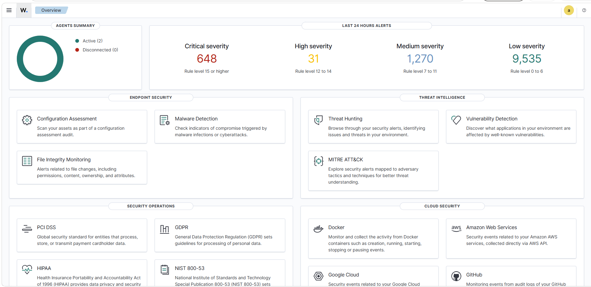
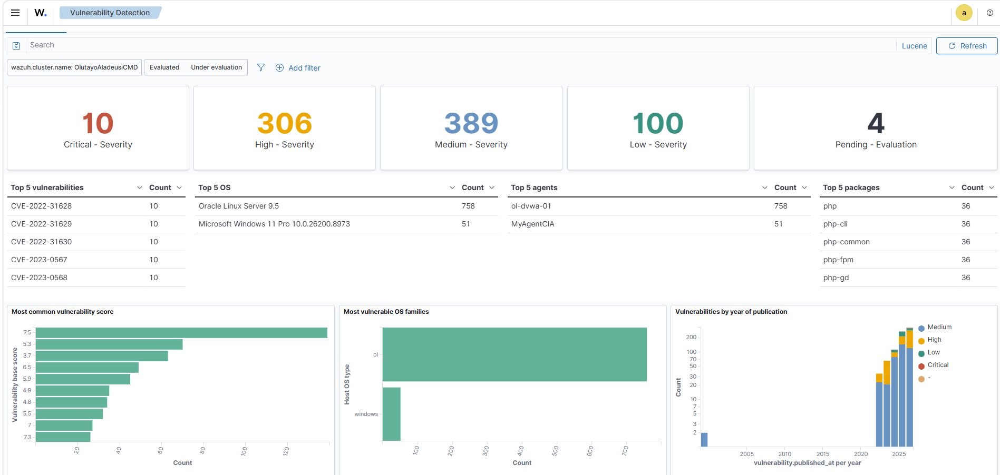
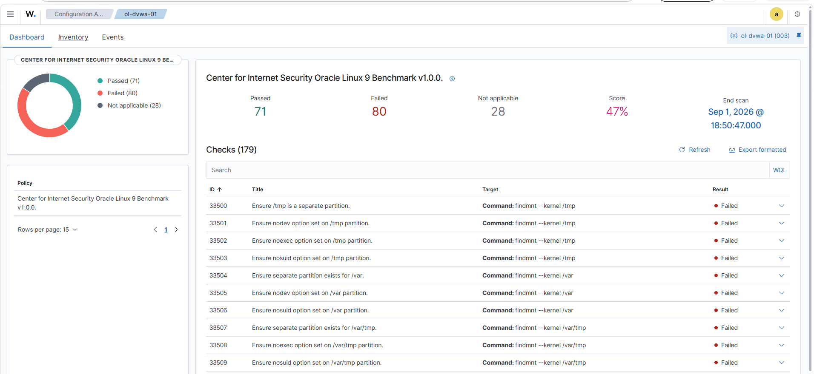
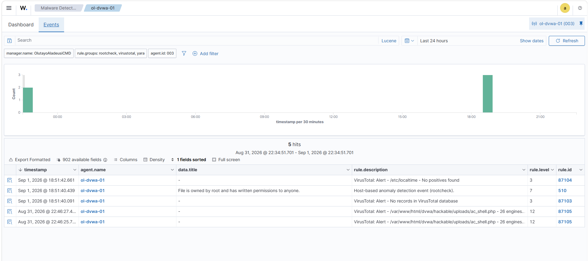
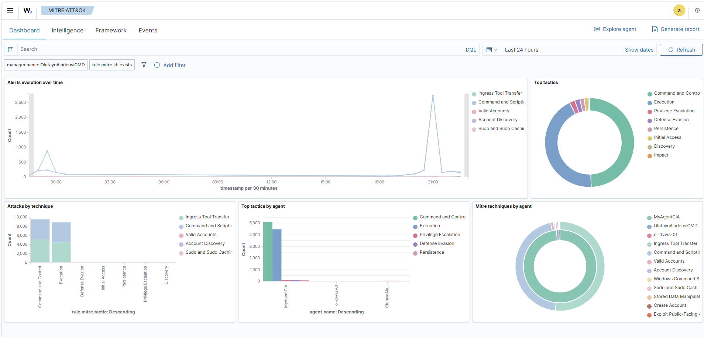
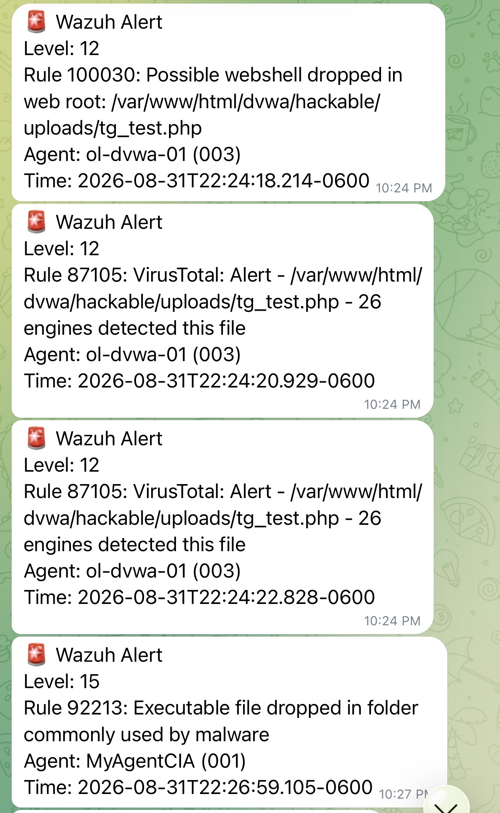

# Wazuh Home SOC Lab — Detection Engineering & Automated Response

A hands-on Security Operations lab built on the **Wazuh SIEM/XDR**: 48 custom detection rules,
five validated detection surfaces, an automated **detect → enrich → respond → notify → report**
pipeline, adversary emulation, and alert tuning — every capability proven with live evidence,
not assumed.

> **The theme that runs through this lab:** *"the rule loaded" and "the rule works" are unrelated
> statements.* A SIEM gives no signal to tell them apart. This project documents **10 distinct ways
> detections fail silently** and how each was found — by firing real attacks and checking which rule
> actually fired.

**Full write-up:** [`docs/Detection_Engineering_Report_Aladeusi.pdf`](docs/Detection_Engineering_Report_Aladeusi.pdf) ·
**Findings log:** [`docs/findings.md`](docs/findings.md) ·
**Architecture:** [`docs/architecture.md`](docs/architecture.md)

---

## What this lab demonstrates

| Capability | What was built | Validation |
|---|---|---|
| **Detection engineering** | 48 custom Wazuh rules across web scanning, brute force, FIM/webshell, web-attack payloads, port scan, post-exploitation, persistence, and Sysmon | Fired live against DVWA + Sysmon |
| **Web attack detection** | SQLi, XSS, traversal, command injection, **successful-exploitation** (attack→HTTP 200) | Verified; SQLi signature-evasion gap characterised |
| **Automated response** | Active-response script auto-quarantines webshells the instant FIM detects them | shell dropped → detected → quarantined in seconds |
| **Threat enrichment** | VirusTotal hash lookup on every FIM file event | EICAR flagged 64/67, rule 87105 |
| **Malware scanning** | YARA content scan via active response on file changes | webshell + EICAR matched, rule 108001 |
| **Network IDS** | Suricata (52k ET rules) feeding eve.json into Wazuh | custom signature → Wazuh rule 86601 |
| **Notifications** | Telegram bot for level-10+ incidents (scoped to real incidents) | live alerts to phone |
| **Compliance / GRC** | NIST 800-53, PCI DSS, HIPAA, GDPR dashboards + CIS-benchmark (SCA) hardening scan | 521 alerts mapped to NIST; CIS scored 47% (71/80/179) |
| **Adversary emulation** | Scripted ATT&CK kill-chain + **MITRE Caldera** (server + Sandcat agent) | chain detected; Caldera proved a command-execution blind spot |
| **Alert tuning** | Scoped suppression of authorised-scanner noise | 40 probes → 0 custom alerts, measured before/after |

---

## Detection surfaces (validated live)

1. **Web-log scanning** — `100012` `100013` `100016`
2. **Web-attack payloads** — `100040` (SQLi) `100042` (XSS) `100043` (traversal) `100044` (cmd) `100045` (**success**)
3. **File integrity / webshell** — `100030` (realtime) + YARA `108001` + VirusTotal `87105`
4. **Network IDS** — Suricata `86601`
5. **Endpoint (Windows)** — Sysmon `92xxx` / `100500`

---

## Dashboard evidence

Every capability above is backed by live captures — see the full gallery in
[`screenshots/`](screenshots/). A few highlights:

| | |
|---|---|
|  |  |
| **Overview** — 2 agents, 24h severity breakdown | **Vulnerability detection** — 10 critical / 306 high |
|  |  |
| **SCA / CIS** — Oracle Linux 9 scored 47% | **VirusTotal** — webshell flagged by 26 engines |
|  |  |
| **MITRE ATT&CK** — tactics/techniques by agent | **Notifications** — live incidents to phone |

> Full set (24 captures): overview, vulnerability detection & inventory, SCA/CIS, malware
> detection, VirusTotal enrichment, FIM, MITRE ATT&CK, Suricata threat hunting, NIST 800-53,
> PCI DSS, GDPR, HIPAA, SOC 2 TSC, and Telegram notifications — in
> [`screenshots/`](screenshots/).

---

## Highlighted findings (the differentiator)

This lab's value is not "it works" — it's the honest catalogue of how detections silently fail.
Ten findings are documented in full in [`docs/findings.md`](docs/findings.md). A few:

- **Wrong field name breaks the payoff rule.** The "successful exploitation" rule checked `<status>`
  but the web decoder stores the HTTP code in `<id>` — so it never fired. Found only by running a
  *real authenticated exploit that returned 200* and noticing the attempt fired while the success
  rule didn't.
- **Custom rules silently shadowed vendor rules** (and vice-versa) — adding rules *reduced* existing
  coverage with no error.
- **Signature vs. behavioural, at scale.** A full ZAP scan evaded the user-agent scanner rule (ZAP
  masks its UA) but tripped the behavioural burst rule 117 times.
- **Adversary emulation proved a blind spot.** MITRE Caldera ran a full ATT&CK Discovery operation
  that host-based detection saw *none of* — because WSL can't run auditd. Quantified the gap and its
  remediation (Sysmon-for-Linux / auditd).
- **Analytical honesty.** One tempting tuning metric (1998→0 alerts) was **discarded** — it was a
  log-rotation artifact, not the tuning. The valid proof is per-probe.

---

## Repository layout

```
wazuh-soc-lab/
├── docs/
│   ├── Detection_Engineering_Report_Aladeusi.pdf   # 8-page report
│   ├── findings.md                                 # 10 documented failure modes + validation tables
│   └── architecture.md                             # topology diagram + surfaces + limitations
├── rules/
│   ├── local_rules.xml                             # 48 custom detection rules + YARA alert rules
│   └── local_decoder.xml                           # YARA output decoder
├── active-response/
│   ├── quarantine-webshell.sh                       # auto-contain webshells (rule 100030)
│   └── yara-scan.sh                                 # YARA scan on FIM change (rule 554 → 108001)
├── integrations/
│   └── custom-telegram                              # Wazuh → Telegram (stdlib, no deps)
├── yara/
│   └── lab_rules.yar                                # webshell + EICAR YARA rules
├── suricata/
│   └── local.rules                                  # Suricata→Wazuh pipeline test rule
├── emulation/
│   └── attack_chain.sh                              # ATT&CK-mapped kill-chain against DVWA
└── screenshots/                                     # dashboard evidence (add your own)
```

## Environment

- **Manager:** Wazuh 4.12 (Ubuntu, WSL2) — indexer + dashboard
- **Target:** OracleLinux 9.5 (WSL2) — LAMP + DVWA, Wazuh agent, Suricata, YARA
- **Attacker:** Kali (WSL2) — OWASP ZAP, curl, MITRE Caldera
- **Endpoint:** Windows host — Sysmon

See [`docs/architecture.md`](docs/architecture.md) for the diagram and the documented WSL platform
limitations (auditd, ufw, shared namespace).

## Roadmap

- Sysmon-for-Linux (eBPF) to close the command-execution blind spot (Finding 10)
- Shuffle SOAR web UI + TheHive case management (engine deployed; UI deferred from WSL to a native VM)
- Enable Suricata ICS/SCADA parsers (Modbus/DNP3/ENIP) for the OT angle
- MISP / OpenCTI threat-intel enrichment

---

*Built as a detection-engineering portfolio. All testing was performed on self-hosted, deliberately
vulnerable lab systems on an isolated network. No production or third-party systems were involved.*
