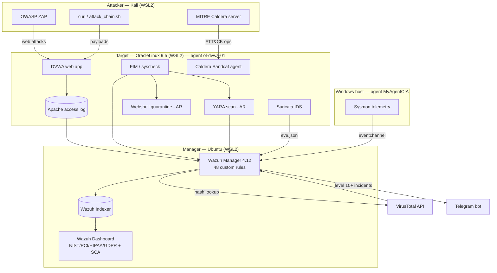

# Lab Architecture

The lab runs on a single Windows host using WSL2 distributions plus a Windows Sysmon endpoint,
sharing one network namespace. It demonstrates a manager/agent SIEM topology with a full
detect → enrich → respond → notify → report pipeline.

## Detection surfaces

| Surface | Source | Example rules |
|---|---|---|
| Web-log scanning | Apache access log | 100012, 100013, 100016 |
| Web-attack payloads | Apache access log | 100040–100046 |
| File integrity / webshell | syscheck (FIM) | 100030 |
| Malware content | YARA (active response) | 108001 |
| Threat reputation | VirusTotal (FIM hashes) | 87105 |
| Network IDS | Suricata eve.json | 86601 |
| Endpoint (Windows) | Sysmon eventchannel | 92xxx, 100500 |

## Platform limitations (WSL2)

- **auditd unavailable** → Linux command-execution rules (100060–100067) inert; proven via Caldera (Finding 10).
- **ufw logging unreliable** → port-scan rules (100050–100052) untested.
- **Shared network namespace** → single source IP; source attribution cosmetic in-lab.
- **Shuffle/TheHive** → SOAR engine deploys but web UI hits Docker-DNS/port quirks; deferred to native VM.
