# Dashboard Evidence

Live captures from the Wazuh dashboard proving each capability the lab claims. All
screenshots are from self-hosted lab systems on an isolated network. Hostnames are the
author's own; no production, customer, or third-party data is present.

---

## Overview

*Wazuh 4.12 overview — 2 active agents; last-24h alert severity: 648 critical, 31 high,
1,270 medium, 9,535 low. Endpoint security, threat intelligence, and compliance modules
all active.*

---

## Vulnerability detection

*Vulnerability Detection — 10 critical, 306 high, 389 medium across Oracle Linux 9.5 and
Windows 11. Top packages by CVE count (php, Node.js, pip) with CVE detail.*

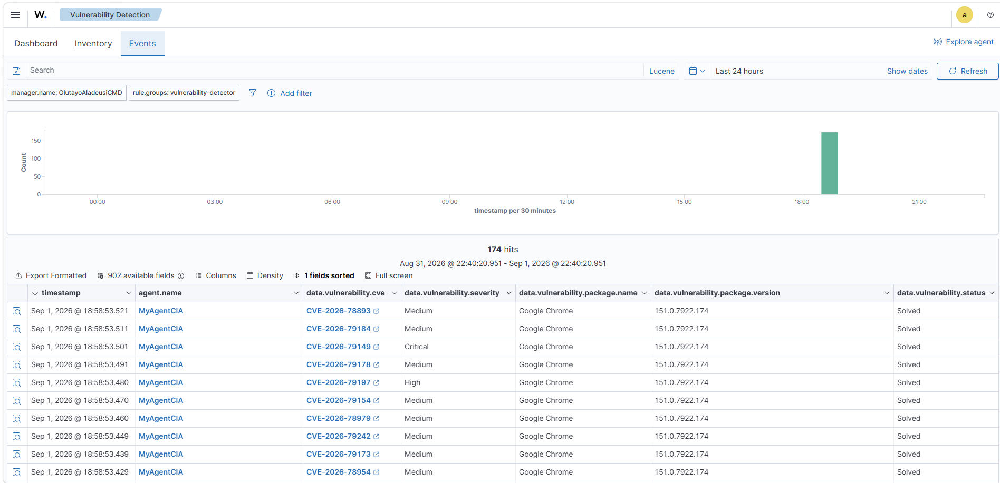

*Per-CVE events with package name/version, severity, and remediation status.*

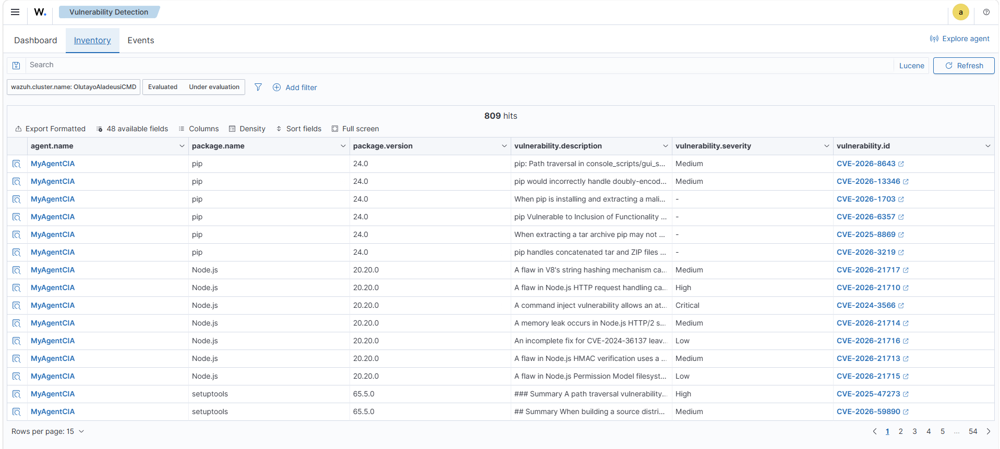

*Full 809-item vulnerability inventory with CVE links and CVSS-mapped severity.*

---

## Configuration assessment (SCA / CIS benchmark)

*CIS Oracle Linux 9 Benchmark v1.0.0 on `ol-dvwa-01` — score 47% (71 passed, 80 failed,
28 N/A across 179 checks). Per-check pass/fail with the exact command each check runs.*

---

## Malware detection & threat enrichment

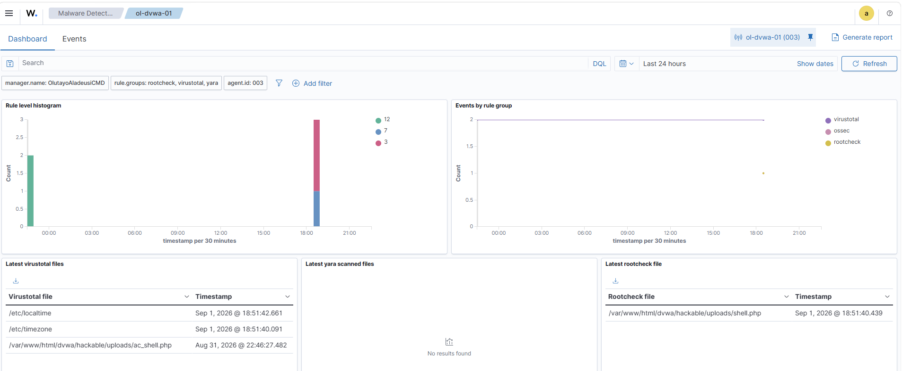

*VirusTotal + YARA + rootcheck activity, including the quarantined webshell
`ac_shell.php` in the DVWA web root.*

*VirusTotal hash lookups on FIM file events — the dropped webshell flagged by **26
engines** (rule 87105, level 12).*

---

## File integrity monitoring

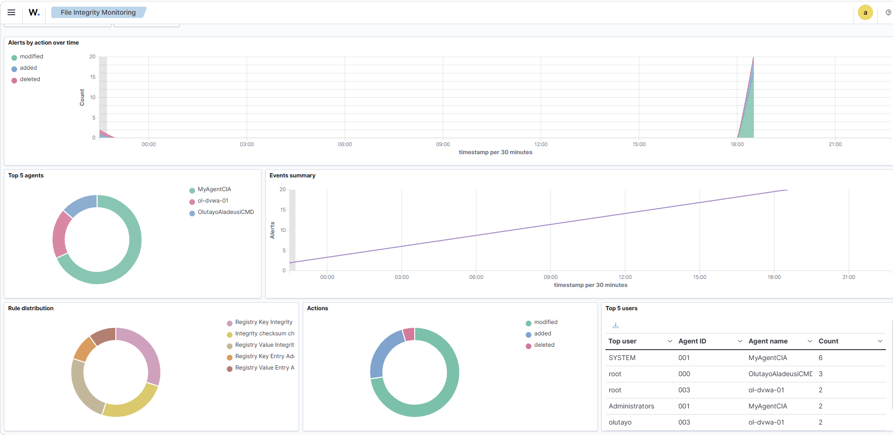

*FIM alerts by action (added / modified / deleted) across all three agents, with top
users and rule distribution.*

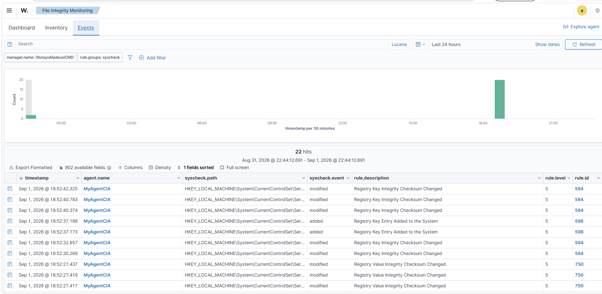

*Real-time syscheck events — registry and file changes with path, action, and rule.*

---

## MITRE ATT&CK

*Alerts mapped to ATT&CK tactics and techniques — top tactics Command & Control,
Execution, Privilege Escalation; techniques broken down per agent.*

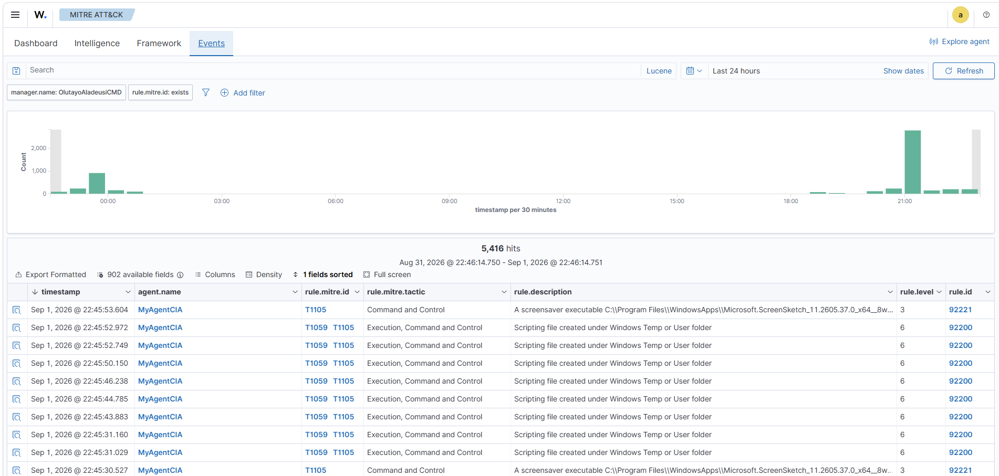

*Technique-tagged events (T1059, T1105, …) with tactic and rule for each alert.*

---

## Threat hunting (Suricata network IDS)

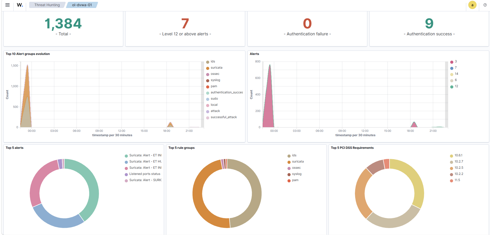

*Threat-hunting view — Suricata ET-rule alerts feeding Wazuh, alert-group evolution, and
authentication success/failure counters.*

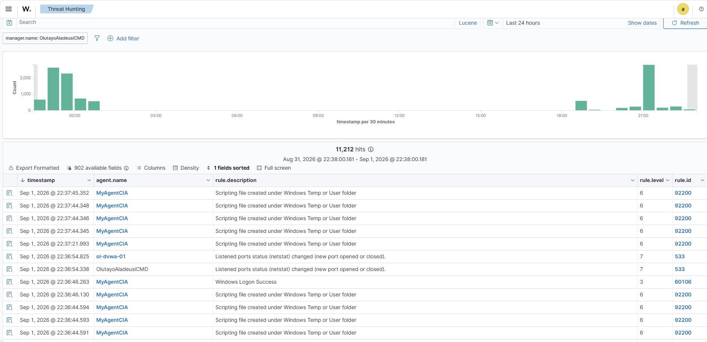

*11,212 hunting events including Suricata IDS alerts and Sysmon script-creation detections.*

---

## Compliance / GRC

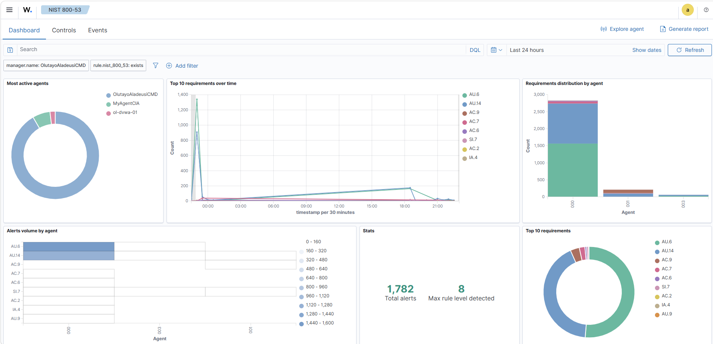

*NIST 800-53 — 1,782 alerts mapped to control families (AU, AC, SI, IA), max rule level 8.*

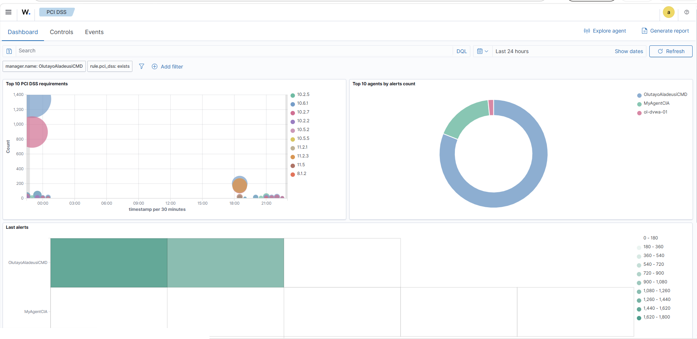

*PCI DSS — top requirements (10.2.x logging/monitoring, 11.2.x scanning) and alerts by agent.*

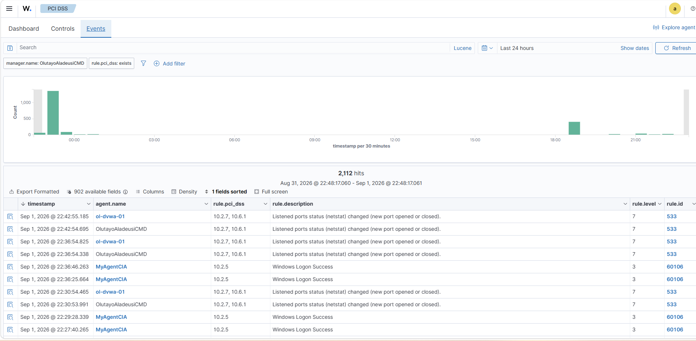

*2,112 PCI-mapped events — netstat port-status changes (10.2.7/10.6.1) and Windows logons.*

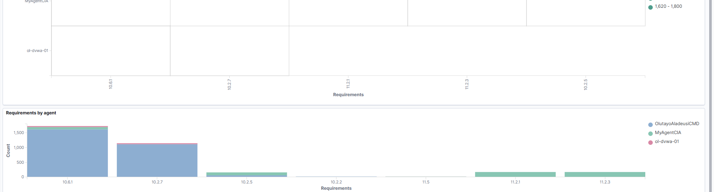

*PCI requirement distribution by agent.*

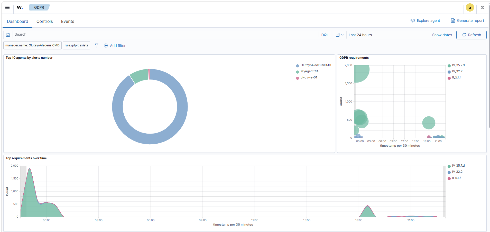

*GDPR — alerts mapped to IV_35.7.d, IV_32.2, II_5.1.f.*

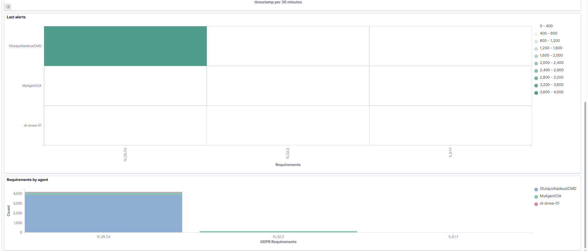

*GDPR requirement distribution by agent.*

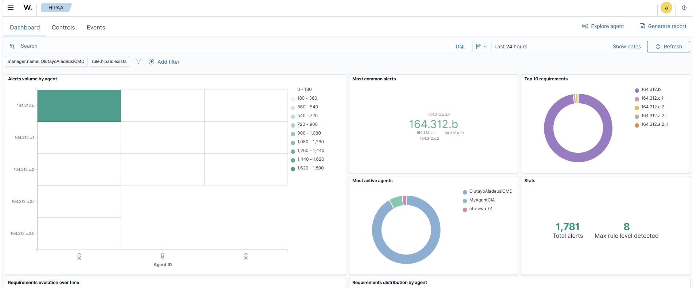

*HIPAA — 1,781 alerts mapped to 164.312 safeguards.*

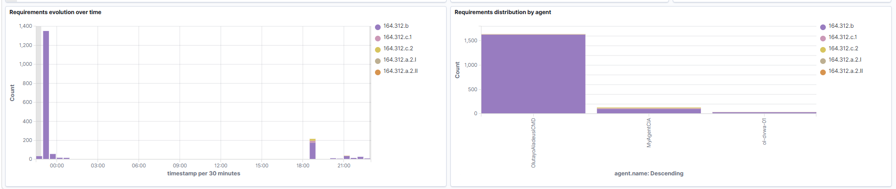

*HIPAA requirement evolution and distribution by agent.*

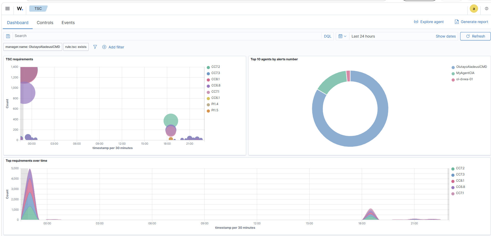

*SOC 2 Trust Services Criteria — CC7.x / CC8.1 / CC6.x common-criteria mapping.*

---

## Notifications (detect → notify pipeline)

*Live Telegram incident alerts on mobile — webshell dropped in web root (rule 100030,
level 12), VirusTotal 26-engine detection (rule 87105), and executable dropped in a
malware-common folder (rule 92213, level 15). Scoped so only real incidents notify.*

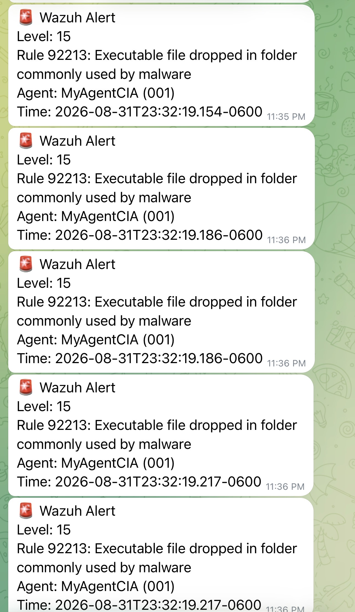

*Level-15 Sysmon incidents delivered in real time to the phone.*
